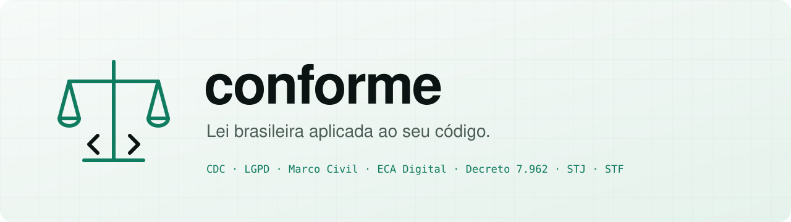
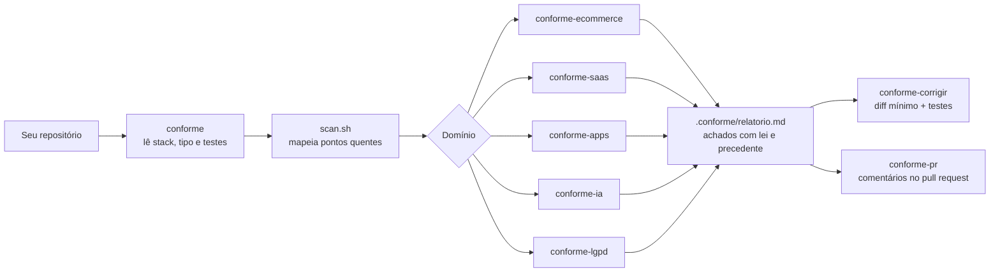

<p align="center">
  <picture>
    <source media="(prefers-color-scheme: dark)" srcset="assets/banner-dark.svg">
    
  </picture>
</p>

<p align="center">
  <a href="LICENSE"></a>
  <a href="https://github.com/manoagois/conforme/actions/workflows/ci.yml"></a>
  
  
</p>

<p align="center">
  <b>Agentes que leem o seu código, apontam o que fere a lei brasileira, citam artigo e precedente, e corrigem sem quebrar a aplicação.</b><br>
  Para e-commerce, SaaS, aplicativos e agentes de IA.
</p>

<p align="center">
  <a href="#instalação">Instalação</a> ·
  <a href="#como-usar">Como usar</a> ·
  <a href="#as-8-skills">Skills</a> ·
  <a href="#cobertura-normativa">Cobertura</a> ·
  <a href="#como-não-quebrar">Como não quebrar</a> ·
  <a href="#contribuindo">Contribuir</a>
</p>

---

## Por que existe

Checklist de compliance genérico não diz em qual linha do seu checkout falta o preço à vista. E agente de IA que "sabe direito" costuma inventar número de processo.

O **conforme** faz o caminho inverso:

1. **Lê o código de verdade.** Todo achado tem `arquivo:linha` e o que aquele trecho faz.
2. **Cita só o que foi conferido.** Leis e precedentes vêm de referências checadas contra o texto oficial. O que não foi conferido aparece marcado, e o agente é proibido de citar número fora da lista sem conferir na hora.
3. **Propõe a correção em diff**, no padrão do seu projeto.
4. **Só aplica com prova.** Roda a linha de base de testes, aplica um achado por commit, escreve teste de regressão e roda tudo de novo.

## Como funciona



## Exemplo de achado

```markdown
### CF-003 · ALTA · Arrependimento só por telefone

**Onde:** `app/orders/[id]/page.tsx:88`
**O que o código faz:** a tela do pedido mostra "Para desistir, ligue para o SAC" e não tem botão.
**Por que é problema:** Decreto 7.962/2013, art. 5º, § 1º: o arrependimento pode ser feito pela
mesma ferramenta usada na compra. CDC art. 49: 7 dias do recebimento, devolução integral e imediata.
**Correção proposta:** botão "Desistir da compra" visível até `deliveredAt + 7 dias`, rota
`POST /orders/:id/withdrawal` que pede o estorno ao gateway (art. 5º, § 3º) e envia confirmação (§ 4º).
**Como provar que não quebrou:** `withdrawal.test.ts` cobre dentro e fora do prazo; build e typecheck verdes.
**Confiança:** alta
```

## As 8 skills

| Skill | Quando dispara | O que olha |
|---|---|---|
| **`conforme`** | "audite meu projeto", "estou conforme a lei?" | Orquestra tudo: detecta stack e tipo, roda o mapeador, chama as skills de domínio e escreve o relatório |
| `conforme-ecommerce` | loja, checkout, marketplace, troca | Preço à vista, parcelamento, frete antes de pagar, identificação do vendedor, arrependimento pelo mesmo canal, estorno, cartão, avaliações |
| `conforme-saas` | assinatura, trial, cancelamento, termos | Renovação com aviso, cancelamento sem barreira, cobrança após cancelar (devolução em dobro), aceite versionado, isolamento entre tenants |
| `conforme-apps` | app web ou mobile, comunidade, público jovem | Cookies antes do consentimento, registros de acesso, exclusão de conta, moderação pela tese do STF, ECA Digital, acessibilidade |
| `conforme-ia` | chatbot, agente, LLM, decisão automática | Aviso de que é IA, PII no prompt, transferência internacional, revisão de decisão automatizada, tools com efeito real, prompt injection |
| `conforme-lgpd` | dados pessoais em qualquer projeto | PII em log, segredos, cartão, senha, IDOR e RLS, direitos do titular em 15 dias, retenção, trilha para incidente |
| `conforme-corrigir` | "corrige esses achados" | Linha de base, um achado por commit, migration aditiva, feature flag em cobrança, teste de regressão, nada de push sem pedido |
| `conforme-pr` | "revisa esse PR" | Comenta só o que o diff muda, com norma e bloco `suggestion`, numa revisão única no GitHub |

## Instalação

As skills seguem o padrão aberto [Agent Skills](https://agentskills.io).

### Claude Code

```text
/plugin marketplace add manoagois/conforme
/plugin install conforme@conforme
```

### Codex

```bash
codex plugin marketplace add manoagois/conforme
codex plugin add conforme@conforme
```

### Gemini CLI

```bash
gemini extensions install https://github.com/manoagois/conforme
```

### Cursor

Rode `/add-plugin` e cole `https://github.com/manoagois/conforme`.

### Manual (qualquer agente que leia `.claude/skills/` ou `~/.claude/skills/`)

```bash
git clone --depth 1 https://github.com/manoagois/conforme.git /tmp/conforme
cp -r /tmp/conforme/skills/conforme* ~/.claude/skills/
rm -rf /tmp/conforme
```

## Como usar

Abra o agente na raiz do projeto e peça em linguagem natural:

```text
audite este projeto com a lei brasileira
revisa o checkout e a página de produto: o que dá Procon?
nossa cobrança recorrente está certa? e o cancelamento?
meu chatbot de WhatsApp está ok com a LGPD?
revisa o PR 42 e comenta o que fere a lei
corrige os achados CF-001 a CF-004 sem quebrar nada
```

O relatório fica em `.conforme/relatorio.md`. Coloque `.conforme/` no `.gitignore` se não quiser versioná-lo.

O mapeador também roda sozinho, sem agente. Ele só lê arquivos:

```bash
bash skills/conforme/scripts/scan.sh caminho/do/projeto
```

## Cobertura normativa

| Norma | Exemplos do que vira achado |
|---|---|
| CDC (Lei 8.078/1990) | oferta vinculante, publicidade enganosa, venda casada, serviço sem pedido, devolução em dobro, arrependimento, contrato de adesão |
| Decreto 7.962/2013 | identificação do fornecedor, resumo do pedido, confirmação, arrependimento pelo mesmo canal com estorno |
| Lei 10.962/2004 | preço à vista junto ao produto com fonte 12, desconto por meio de pagamento visível |
| Decreto 11.034/2022 | SAC e cancelamento imediato em serviços regulados |
| LGPD (Lei 13.709/2018) e resoluções da ANPD | segurança, necessidade, direitos do titular, consentimento, retenção, incidente em 3 dias úteis |
| Marco Civil (Lei 12.965/2014) | registros de acesso por 6 meses, consentimento destacado, exclusão ao fim da relação |
| ECA Digital (Lei 15.211/2025) | padrão protetivo, verificação de idade sem autodeclaração, contas vinculadas, loot boxes, perfilamento |
| LBI (Lei 13.146/2015) | acessibilidade de sites e apps |

### Jurisprudência

| Tribunal | Precedente | Status |
|---|---|---|
| STF | Temas 987 e 533: art. 19 do Marco Civil parcialmente inconstitucional, dever de cuidado, presunção em anúncio pago e bots | conferido |
| STF | Tema 786: direito ao esquecimento | conferido |
| STJ | Súmulas 297, 359, 385, 479, 532, 550 e 608 | conferidas |
| STJ | Tema 710: credit scoring | conferido |
| STJ | Tema 929: devolução em dobro (mérito julgado em 2026-09-15, acórdão pendente) | conferido |
| STJ | EAREsp 676.608/RS, AREsp 2.130.619/SP, REsp 1.758.799/MG, REsp 1.495.920/DF | a conferir |

Textos e fontes em [`jurisprudencia.md`](skills/conforme/references/jurisprudencia.md). Leis em [`legislacao.md`](skills/conforme/references/legislacao.md).

A conferência usa o acervo aberto [ctresb-leis](https://github.com/leoparreira21/ctresb-leis), que reúne legislação federal, estadual e jurisprudência dos tribunais superiores em Markdown com link para a fonte oficial. O agente consulta o arquivo pontual quando precisa conferir algo fora da lista ([como](skills/conforme/references/verificacao.md)).

## Como não quebrar

A skill `conforme-corrigir` segue um protocolo fixo:

- descobre e roda os comandos de teste, build, lint e typecheck **antes** de mexer;
- trabalha numa branch `conforme/<achado>`, um achado por commit;
- mudanças em banco são migrations aditivas com rollback escrito;
- mudanças em cobrança ficam atrás de feature flag ou data de corte; estorno em lote só com dry-run revisado;
- exclusão de dados só com contagem prévia e respeitando guarda obrigatória;
- escreve teste de regressão para cada correção de lógica;
- roda tudo de novo e não entrega vermelho;
- não faz push, merge, deploy nem apaga dado de produção sem pedido explícito.

## Relação com outros projetos

- [goul4rt/lgpd-skills](https://github.com/goul4rt/lgpd-skills) cobre a LGPD documental (ROPA, RIPD, DPA, política, incidente). O conforme foca no que o código faz e em outras leis além da LGPD. Os dois se complementam; a skill `conforme-lgpd` indica o outro para documentos.
- [leoparreira21/ctresb-leis](https://github.com/leoparreira21/ctresb-leis) é a base de conferência das leis e precedentes.

## Desenvolvimento

```bash
bash tests/run.sh
```

O teste confere que o mapeador encontra os problemas plantados em `tests/fixtures/loja`, que toda skill tem `name` igual à pasta e `description`, que os links internos existem e que os manifestos são JSON válido. O CI roda o mesmo teste e o shellcheck.

```
conforme/
├── skills/
│   ├── conforme/              orquestrador
│   │   ├── references/        legislação, jurisprudência, verificação, formato
│   │   └── scripts/scan.sh    mapeador de pontos quentes
│   ├── conforme-ecommerce/
│   ├── conforme-saas/
│   ├── conforme-apps/
│   ├── conforme-ia/
│   ├── conforme-lgpd/
│   ├── conforme-corrigir/
│   └── conforme-pr/
├── tests/                     fixture e testes
├── .claude-plugin/  .codex-plugin/  .cursor-plugin/  gemini-extension.json
└── assets/                    banner
```

## Contribuindo

Precedente novo, tese publicada, lei que mudou: abra uma issue com o template **Precedente novo ou desatualizado**. Todo item entra com link da fonte oficial e data da conferência. Detalhes em [CONTRIBUTING.md](CONTRIBUTING.md).

## Aviso

Este projeto é ferramenta de engenharia, não parecer jurídico. As referências foram conferidas na data indicada e podem mudar. Decisões com risco relevante pedem revisão de um advogado.

## Licença

[MIT](LICENSE)
